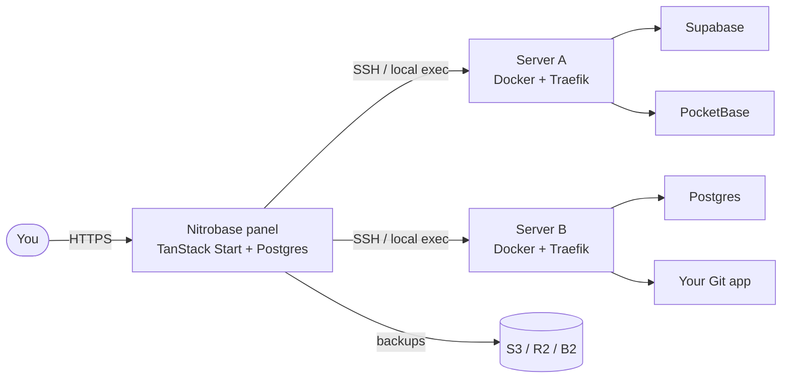

<div align="center">



# Nitrobase

**Your own platform-as-a-service, on your own servers.**

Connect a VPS over SSH, let Nitrobase set up Docker and Traefik, and deploy Supabase, Appwrite, PocketBase,<br/>
databases or your own Git repository in a few clicks, with HTTPS, backups, monitoring and updates built in.

[Website](https://nitrobase.app) ·
[Install](#install) ·
[Features](#features) ·
[Templates](#app-templates) ·
[Development](#development) ·
[License](#license)


</div>

---

## Why Nitrobase

Hosted backends are convenient until the bill, the region or the data policy stops fitting. Nitrobase gives you the same "click to deploy" experience on machines you control:

- **Bring any VPS.** Add a server with an SSH key, or use the machine Nitrobase runs on. Bootstrap shows exactly what it will change before it touches anything.
- **Backends, not only containers.** First-class templates for Supabase, Appwrite and PocketBase, with their secrets generated, their admin logins shown, and their data backed up the way each app needs.
- **Safe by default.** Every compose file, template or your own, goes through the same policy: no host mounts outside the app folder, no privileged containers, no reserved labels or networks.
- **Operations included.** Backups to S3/R2/B2 with verified restores, monitoring and alerts, one-click updates with automatic rollback, moving an app to another server, a web terminal and database consoles.

## Features

| | |
|---|---|
| **Servers** | SSH or local host, guided bootstrap (Docker, Traefik v3, firewall checks), ownership markers so two panels never fight over one server, Cloudflare Tunnel support |
| **Apps** | Marketplace templates, custom `docker-compose.yml`, Git repositories (Dockerfile, Railpack or static) redeployed on push, per-app env editor with secret masking, resource limits, scheduled tasks |
| **Domains** | Free `*.sslip.io` domain with HTTPS on deploy, your own domains with Let's Encrypt, DNS checks, routing through Cloudflare Tunnel |
| **Databases** | PostgreSQL, MySQL, MariaDB, MongoDB and Valkey with a web console, connection strings and links to your apps |
| **Backups** | App backups (database dumps taken after writers stop, plus volumes) to S3, R2, B2 or a server folder; schedules, retention, restore in place or as a new app; an encrypted self-backup of the panel |
| **Monitoring** | Server and container metrics, health, restart loops, OOM kills, stopped services, disk and memory alerts, notifications by email, Slack, Discord, Telegram or webhook |
| **Updates** | Update checks for templates, database images and Git branches; backup-first updates with automatic rollback; maintenance windows; in-panel upgrade of Nitrobase itself |
| **Teams** | Teams with owner, admin, developer and viewer roles, invites, two-factor authentication, audit log, personal and team API tokens with a REST API and OpenAPI document |
| **Languages** | English and Vietnamese (Lingui); new languages are a catalog away |

## App templates

| Template | What you get |
|---|---|
| **Supabase** | Postgres platform: database, auth, REST and realtime APIs, storage, edge functions and Studio. Can import a hosted Supabase project. |
| **Appwrite** | Auth, databases, storage, messaging and realtime, with the Appwrite console. |
| **PocketBase** | A one-file backend: realtime database, auth, file storage and admin dashboard. |
| **Database** | A standalone PostgreSQL, MySQL, MariaDB, Valkey or MongoDB server. |
| **n8n** | Workflow automation with 400+ integrations, code steps and AI agents. |
| **Plausible** | Privacy-first web analytics on ClickHouse and Postgres. |
| **Umami** | Cookie-free web analytics. |
| **RustFS** | S3-compatible object storage with a web console. |
| **From Git repository** | Your own code from a branch, built with a Dockerfile, Railpack or as a static site. |
| **Custom compose** | Paste any `docker-compose.yml`; it goes through the same safety rules as every template. |

Templates are plain folders (`template.toml` + `docker-compose.yml`) under [`templates/`](templates/README.md), so adding one needs no code change.

## Install

Releases are published on [GitHub](https://github.com/AydenGroup/nitrobase/releases), with multi-arch images (amd64 and arm64) at `ghcr.io/aydengroup/nitrobase` and the installer image at `ghcr.io/aydengroup/nitrobase-installer`. Every method below produces the same layout: a `.env` and a compose file in one folder, with the compose project `nitrobase` and the container `nitrobase_app`, so the in-panel upgrade works the same way for each.

### With Docker (any OS with Docker)

On any machine with [Docker](https://docs.docker.com/get-docker/) (amd64 or arm64, 2 GB RAM recommended), one command installs Nitrobase:

```bash
docker run --rm -it \
  -v /var/run/docker.sock:/var/run/docker.sock \
  -v /opt/nitrobase:/opt/nitrobase \
  ghcr.io/aydengroup/nitrobase-installer:beta
```

The image runs the [install script](#with-the-install-script-ubuntu-or-debian-vps) below, through your Docker instead of the host's package manager. It skips the OS check and the Docker install, writes the same `/opt/nitrobase/.env` with generated secrets and a one-time setup token, starts Nitrobase, waits until it is healthy, and prints the panel URL, the setup token and the reminder to **back up the secrets**. Any [installer option](#installer-options) can follow the image name.

The two mounts:

- `-v /var/run/docker.sock:/var/run/docker.sock` lets the installer drive your Docker. Without it, the installer stops with an error that names this flag.
- `-v /opt/nitrobase:/opt/nitrobase` is the install folder. It **must be the same path on both sides**: Docker resolves the compose project folder on the host, and the in-panel upgrade mounts that folder again later. The installer checks this and prints the exact `-v` to use if it is missing or different. For another folder, change both sides and pass `--dir`: `-v /srv/nitrobase:/srv/nitrobase ... --dir /srv/nitrobase`.

**Version.** Nitrobase is in beta, so the commands here use `:beta`, which always installs the newest pre-release. `:latest` installs the latest stable release and exists from the first stable release on. `ghcr.io/aydengroup/nitrobase-installer:<version>` (for example `:0.1.0-beta.0`) installs exactly that release. `--version <v>` overrides the image's version. On an existing install, the version already installed is kept unless you pass `--version`, so an older installer image never downgrades it.

**Upgrade and uninstall** use the same image and mounts:

```bash
docker run --rm -it -v /var/run/docker.sock:/var/run/docker.sock -v /opt/nitrobase:/opt/nitrobase \
  ghcr.io/aydengroup/nitrobase-installer:beta --version <v>        # upgrade (or Settings → Instance)
docker run --rm -it -v /var/run/docker.sock:/var/run/docker.sock -v /opt/nitrobase:/opt/nitrobase \
  ghcr.io/aydengroup/nitrobase-installer:beta --uninstall          # stop; data and .env stay
docker run --rm -it -v /var/run/docker.sock:/var/run/docker.sock -v /opt/nitrobase:/opt/nitrobase \
  ghcr.io/aydengroup/nitrobase-installer:beta --uninstall --purge  # also delete the data
```

`--purge` empties the install folder. The empty folder itself stays on the host, because it is the mount point (`rmdir /opt/nitrobase` removes it).

**`-it` or not.** With `-it` the installer can ask questions: `--purge` asks you to type `purge <dir>`. Without a terminal (CI, scripts), drop `-it`. Nothing else asks, so `--yes` is implied, and `--purge` needs `-e NITROBASE_PURGE_CONFIRM="purge /opt/nitrobase"` instead.

**Ports.** A container cannot see the host's sockets, so the installer only checks the ports that other containers publish. If another program on the host uses port 3000, `docker compose up` fails and the installer tells you to pick another port with `--panel-bind 0.0.0.0:<port>`. The installer cannot know the host's address, so it prints `http://<server-ip>:3000`: use your server's address, or `http://localhost:3000` on the machine itself.

**Docker Desktop (macOS, Windows).** The panel's *Localhost* server is Docker's Linux VM, not your computer: apps deployed to it run inside that VM. Docker Desktop only mounts folders it shares, and `/opt` is not one of them on macOS. Install under your home folder instead, which is shared by default:

```bash
docker run --rm -it \
  -v /var/run/docker.sock:/var/run/docker.sock \
  -v "$HOME/nitrobase:$HOME/nitrobase" \
  ghcr.io/aydengroup/nitrobase-installer:beta --dir "$HOME/nitrobase"
```

The path may only contain letters, digits, `.`, `_`, `-` and `/`. Then open `http://localhost:3000`. On Windows, run the command from a WSL 2 shell.

### With the install script (Ubuntu or Debian VPS)

On a fresh **Ubuntu or Debian** VPS (amd64 or arm64, 2 GB RAM recommended):

```bash
curl -fsSL https://nitrobase.app/install.sh | sudo bash
```

If nitrobase.app is unreachable, use the copy attached to the latest release: `https://github.com/AydenGroup/nitrobase/releases/latest/download/install.sh`. A running Nitrobase also serves the installer of its own version at `https://<panel>/api/install.sh`.

The installer is idempotent. It:

1. checks the OS, CPU, RAM, disk and ports, and installs Docker from Docker's apt repository if it is missing (it asks first; `--yes` skips the question);
2. creates `/opt/nitrobase` with a `0600` `.env` holding generated secrets, and reminds you to **back them up off the server**;
3. generates a one-time **setup token**, so nobody who reaches the fresh panel before you can claim it;
4. downloads the release's `docker-compose.prod.yml`, starts it, waits until the panel is healthy and prints the next steps.

Without `--version` it installs the latest release. Until the first stable release exists, it installs the newest pre-release. When it installs a pre-release and `.env` has no `RELEASE_CHANNEL`, it sets `RELEASE_CHANNEL=prerelease` so the panel offers the next pre-releases. A later stable install removes that setting again, but only if the installer wrote it; a channel you set yourself is kept. A re-run keeps the `--repo`, `--image`, `--api-url` and `--panel-bind` of the existing install (`RELEASE_REPO`, `NITROBASE_IMAGE`, `RELEASE_API_URL` and `PANEL_BIND` in `.env`).

<details id="installer-options">
<summary>Installer options</summary>

| Option | Meaning |
|---|---|
| `--version <v>` | Release to install (default: latest). Re-run with another version to change it. |
| `--dir <path>` | Install folder (default `/opt/nitrobase`). |
| `--panel-bind <addr:port>` | Where the panel listens (default `0.0.0.0:3000`). |
| `--domain <host>` | Serve the panel on a domain with Let's Encrypt; binds it to `127.0.0.1:3000` and sets `APP_URL` and `TRUST_PROXY`. |
| `--image <name>`, `--compose-url <url>` | Use another image or compose file. |
| `--repo <owner/name>` | Install the releases of a fork (default `AydenGroup/nitrobase`; image `ghcr.io/<owner/name>`). For Gitea or Forgejo, add `--api-url https://<host>/api/v1 --raw-url https://<host>/<owner>/<name>/raw/tag`. |
| `--uninstall` | Stop Nitrobase, keep data and `.env`. |
| `--uninstall --purge` | Also delete the data (asks you to type `purge <dir>`). |
| `--print-config`, `--help` | Show the resolved settings or the help. |

</details>

### By hand with Docker Compose

In an empty folder, with [Docker](https://docs.docker.com/get-docker/) and Docker Compose v2. Pick `VERSION` from the [releases](https://github.com/AydenGroup/nitrobase/releases); the compose file and `.env` must come from the same release.

```bash
mkdir nitrobase && cd nitrobase
VERSION=0.1.0-beta.0
BASE=https://github.com/AydenGroup/nitrobase/releases/download/v$VERSION
curl -fsSL -o compose.yaml "$BASE/docker-compose.prod.yml" && curl -fsSL -o .env "$BASE/env.example"
for key in ENCRYPTION_KEY SESSION_SECRET POSTGRES_PASSWORD; do sed -i.bak "s|^$key=.*|$key=$(openssl rand -hex 32)|" .env; done
sed -i.bak "s|^NITROBASE_VERSION=.*|NITROBASE_VERSION=$VERSION|" .env && rm .env.bak && chmod 600 .env
case "$VERSION" in *-*) echo "RELEASE_CHANNEL=prerelease" >> .env ;; esac  # a pre-release: offer the next ones
docker compose up -d
docker compose logs app | grep "Setup token"
```

The last command prints the one-time setup token (it can take a minute while the database migrates). Then open `http://localhost:3000`, or `http://<server-ip>:3000` on a server. Back up `.env`, especially `ENCRYPTION_KEY`, somewhere other than this machine.

On **Docker Desktop** (macOS, Windows), the panel's *Localhost* server is Docker's Linux VM, not your computer: apps deployed to it run inside that VM.

### First steps

Open `http://<server-ip>:3000`, ideally through an SSH tunnel (`ssh -L 3000:localhost:3000 root@<server-ip>`), enter the setup token and create the first account: it becomes the administrator. The install script printed the token (it is `SETUP_TOKEN` in `.env`). Without `SETUP_TOKEN`, the panel generates one and prints it to its logs until the first account exists: `docker compose logs app | grep "Setup token"`. Moving an existing Nitrobase here? Choose **Restore from a backup** instead.

The dashboard's **Getting started** checklist then walks you through:

1. **Get a server ready**: bootstrap *Localhost* or add a VPS.
2. **Deploy your first app** from the marketplace; a free `sslip.io` domain with HTTPS is set up for you.
3. **Add an off-site backup destination** (S3, R2, B2) and a schedule.
4. **Turn on notifications, two-factor authentication and a panel domain** with HTTPS (Settings → Instance).

<details>
<summary>Install from a checkout instead</summary>

```bash
git clone https://github.com/AydenGroup/nitrobase.git && cd nitrobase
cp .env.example .env
for key in ENCRYPTION_KEY SESSION_SECRET POSTGRES_PASSWORD; do
  sed -i "s|^$key=.*|$key=$(openssl rand -hex 32)|" .env
done
sed -i 's|^NITROBASE_IMAGE=.*|NITROBASE_IMAGE=nitrobase|; s|^NITROBASE_VERSION=.*|NITROBASE_VERSION=local|' .env
chmod 600 .env
docker compose -f docker-compose.prod.yml -f docker-compose.build.yml up -d --build
```

Keep `ENCRYPTION_KEY` somewhere other than this machine: backups and stored credentials cannot be read without it.

</details>

## How it works



- The **panel** is one container plus its PostgreSQL. It keeps the desired state (servers, apps, env, domains, schedules) and runs jobs: deploys, backups, updates, moves.
- Each **server** runs Docker and a Traefik reverse proxy. Every app is a compose project in its own folder under `/etc/nitrobase/apps`, on a shared proxy network, with labels that tie it to this panel.
- **Jobs** are logged live, hold per-server and per-app locks, and resume or roll back cleanly if the panel restarts mid-way.
- **Secrets** (SSH keys, app passwords, destination credentials) are encrypted at rest with `ENCRYPTION_KEY`.

## Operating Nitrobase

### Production checklist

- Put the panel behind HTTPS (`--domain`, or Settings → Instance) and set `APP_URL=https://…` so session cookies are `Secure`; then bind it to `127.0.0.1:3000` so plain HTTP is no longer reachable.
- Behind the panel's own Traefik route, set `TRUST_PROXY=true` so sign-in rate limits and the audit log see real client addresses (`TRUSTED_PROXY_HOPS`, default 1).
- Back up `.env`, especially `ENCRYPTION_KEY`, outside the server.
- Run **one** panel instance: jobs, locks and the scheduler live in-process.
- The panel container runs privileged with `pid: host`, so it can manage the host it runs on through `nsenter`. PostgreSQL is never published to the host.
- Any setting from `src/config/server.ts` can be set in `.env`; the panel reads it through `env_file`.

### Upgrading

**From the panel** (both install methods): Settings → Instance shows the running version and the latest release. By default it checks `AydenGroup/nitrobase`. A fork sets `RELEASE_REPO=owner/name`, and a Gitea or Forgejo host also sets `RELEASE_API_URL`. `UPDATE_CHECK_ENABLED=false` turns the check off. Pre-releases are offered only with `RELEASE_CHANNEL=prerelease`. **Upgrade** then:

1. waits until no job runs, and refuses new jobs until it ends;
2. takes a mandatory self-backup to the destination you choose;
3. pulls the new image and starts a short-lived **updater** container, which sets `NITROBASE_VERSION` in `.env` (keeping `.env.before-upgrade`) and recreates the panel;
4. waits for the new panel to be healthy, otherwise puts the previous version back.

The database is not rolled back automatically: if a new version migrated it and then failed, restore the self-backup from step 2.

**From the shell:** re-run the installer (the script or the installer image) with `--version <v>`. Or, in the install folder, download the new release's compose file, set `NITROBASE_VERSION` in `.env` and run `docker compose up -d`.

### Backups and disaster recovery

App backups and the Nitrobase self-backup live under **Data → Destinations** and **Data → Backups**. Runs missed while the panel was down are caught up at the next start.

The **self-backup** is a `pg_dump` of the panel database plus a manifest, as a gzipped tar encrypted with `ENCRYPTION_KEY`. To recover on a new machine:

- **From the panel (recommended):** install a fresh Nitrobase, choose **Restore from a backup** on the first page, enter the setup token, upload the `nitrobase/<date>-<id>.tar.gz.enc` file, its sha256 (shown in Data → Backups) and the old `ENCRYPTION_KEY`. Nitrobase verifies, decrypts and loads it as an unprivileged role, runs this version's migrations and re-encrypts secrets for the new key. The restored panel starts **paused** until you confirm it should take over.
- **By hand:**

  ```bash
  sha256sum backup.tar.gz.enc                     # compare with the checksum in Data → Backups
  export ENCRYPTION_KEY='<the old key>'
  openssl enc -d -aes-256-cbc -pbkdf2 -md sha256 -iter 200000 \
    -pass env:ENCRYPTION_KEY -in backup.tar.gz.enc | tar -xzf -
  docker compose -f docker-compose.prod.yml up -d postgres
  docker compose -f docker-compose.prod.yml exec -T postgres \
    psql -U nitrobase -d nitrobase < nitrobase-backup/nitrobase.sql
  docker compose -f docker-compose.prod.yml up -d
  ```

  Start the fresh install with the **same** `ENCRYPTION_KEY` and `SESSION_SECRET`.

**Split-brain guard.** The database stores an instance id and each panel keeps a marker on its data volume. A database restored on another machine does not match, so that panel boots paused: no jobs, schedules or monitoring, until an administrator chooses **"This database was moved — resume here"**. Stop the old installation for good first.

<details>
<summary>Rotating <code>ENCRYPTION_KEY</code></summary>

Stop the panel and run the rotation script with `OLD_ENCRYPTION_KEY` set to the current key and `ENCRYPTION_KEY` to the new one:

```bash
docker compose -f docker-compose.prod.yml stop app
docker compose -f docker-compose.prod.yml run --rm \
  -e OLD_ENCRYPTION_KEY='<current key>' -e ENCRYPTION_KEY='<new key>' \
  app bun scripts/rotate-encryption-key.ts
```

Then put the new key in `.env` and start the panel again.

App backups made before the rotation keep their `env.enc` encrypted with the old key, and so does the self-backup. Put the old key in `ENCRYPTION_KEY_PREVIOUS` (comma separated, newest first) until those backups have aged out. To decrypt an older self-backup by hand, pass the old key to `openssl`.

</details>

### App updates

Apps with versioned sources are checked on `APP_UPDATE_CHECK_CRON`, and **Update available** shows in the lists, the sidebar and the dashboard. **Update** backs up first, deploys the new version and, if the deploy or health check fails, rolls back: by redeploying the previous version, or by restoring the backup when the template says the upgrade migrates data irreversibly. Each app can also auto-apply patch or minor releases inside a maintenance window (`APP_AUTO_UPDATE_CRON`).

### Moving an app

**App → Settings → Move to another server** backs the app up, restores it with the same id, data and env on the target, checks its health there and only then removes it from the source. Any failure removes the copy and restarts the app on the source. Free `sslip.io` domains follow automatically; for your own domains the job log lists the DNS records to change.

### Cloudflare Tunnel

A server can publish its apps through a [Cloudflare Tunnel](https://developers.cloudflare.com/cloudflare-one/connections/connect-networks/) instead of open ports. Nitrobase only needs the connector token and never calls the Cloudflare API:

1. Create a tunnel in Zero Trust → Networks → Tunnels and copy its token.
2. In Nitrobase, Server → Settings → Cloudflare Tunnel: paste the token, enable it, and optionally choose **Tunnel only** so ports 80/443 can stay closed.
3. For each domain, add a public hostname with service `http://nitrobase-traefik:8081` and mark the domain *Via Cloudflare Tunnel*.

Tunnel routes live on a private Traefik entrypoint that only cloudflared can reach, so nobody can bypass Cloudflare Access through the server's public IP.

### Importing from Supabase cloud

**Settings → Cloud connections** stores a hosted project's credentials. **Apps → New app → Import from Supabase cloud** then creates a Supabase app with its database, storage files, edge functions and cron jobs. The database is reached with `sslmode=verify-full`: put Supabase's root certificates (`prod-ca-2021.crt` and `prod-ca-2025.crt` from [supabase/cli](https://github.com/supabase/cli)) into `certs/supabase-root-ca.pem`, or point `CLOUD_SYNC_SUPABASE_CA_FILE` at your own bundle.

### Teams, roles and the API

Everything belongs to a **team**. The first account becomes the instance administrator; after that, people join through invites. Roles: **owner**, **admin**, **developer** (deploy and operate, restore backups) and **viewer** (read-only, secrets hidden), defined in `src/config/permissions.ts`.

API tokens (Settings → API tokens) call the REST API at `/api/v1` with `Authorization: Bearer nbk_…`. Tokens are shown once, stored as a hash, expire, are rate limited, and every action is audited. The OpenAPI document is at `/api/v1/openapi.json`.

```bash
curl -H "Authorization: Bearer $TOKEN" https://panel.example.com/api/v1/apps
curl -X POST -H "Authorization: Bearer $TOKEN" https://panel.example.com/api/v1/apps/<appId>/redeploy
curl -N -H "Authorization: Bearer $TOKEN" https://panel.example.com/api/v1/jobs/<jobId>/stream
```

## Development

**Requirements:** [Bun](https://bun.sh) and Docker (for the local PostgreSQL).

```bash
bun install
cp .env.example .env.local        # fill in the secrets: openssl rand -hex 32
docker compose up -d postgres     # PostgreSQL on 127.0.0.1:5443
bun run db:migrate
bun run dev                       # http://localhost:3000
```

| Command | What it does |
|---|---|
| `bun run dev` | Dev server with hot reload |
| `bun run build` | Production build |
| `bun run typecheck` | TypeScript |
| `bun run check` | Biome lint and format check |
| `bun run test` | Vitest |
| `bun run i18n:extract && bun run i18n:compile` | Update and compile the translation catalogs |
| `bun run db:generate` | New Drizzle migration from the schema |

### Releasing

Releases are built by GitHub Actions (`.github/workflows/release.yml`) from a version tag:

1. Bump `version` in `package.json` (semver, e.g. `0.1.0` or `0.2.0-beta.1`) and the `VERSION=` example under [Install](#install). For the first stable release, also switch the installer commands under [Install](#install) from `:beta` to `:latest` (a test checks both). Commit and push to `main`.
2. Tag the commit and push the tag to GitHub: `git tag v0.2.0 && git push origin v0.2.0`.

The workflow then:

- runs the CI checks;
- fails if the tag is not `v` + the `package.json` version;
- builds `linux/amd64` and `linux/arm64` and pushes `ghcr.io/aydengroup/nitrobase:<version>` and the installer image `ghcr.io/aydengroup/nitrobase-installer:<version>`, plus `:latest` when it is the highest stable version, or `:beta` for a pre-release (`:latest` stays on the latest stable);
- creates the GitHub Release, marked as a pre-release for `-` versions, with generated notes and `docker-compose.prod.yml`, `install.sh` and `env.example` attached. It becomes the "latest" release only when it is the highest stable version, so a backport tag (`v1.2.4` after `v1.3.0`) leaves `v1.3.0` as latest, for both the Release and the `:latest` image.

### Database migrations

The schema lives in `src/db/schema/*.ts`, and `drizzle/` starts from a single baseline (`0000_baseline.sql`). To change the schema, edit `src/db/schema/`, run `bun run db:generate` (commit the new SQL file and its snapshot), then `bun run db:migrate`. SQL that Drizzle cannot express from the schema, such as triggers or data fixes, goes into a custom migration: `bunx drizzle-kit generate --custom --name <name>`.

### Environment

| Variable | Required | Notes |
|---|---|---|
| `DATABASE_URL` | yes | PostgreSQL connection string. |
| `ENCRYPTION_KEY` | yes | ≥ 32 random characters. Encrypts secrets at rest; changing it makes them unreadable. |
| `SESSION_SECRET` | yes | ≥ 32 random characters. Seals the session cookie. |
| `APP_URL` | no | Public URL of the panel; cookies are `Secure` only when it starts with `https://`. |
| `ACME_EMAIL` | no | Let's Encrypt account email; defaults to the administrator's email. |
| `GITHUB_TOKEN` | no | Raises GitHub API rate limits when listing template versions. |

The server refuses to start when a required secret is missing, too short or a known placeholder. Every other setting, with its default, lives in `src/config/server.ts`.

### Tech stack

- **Runtime:** Bun · **Framework:** TanStack Start (React 19, nitro)
- **Data:** TanStack Router and Query · PostgreSQL with Drizzle ORM
- **UI:** Mantine 9 · Lucide icons · React Compiler
- **i18n:** Lingui (English source, Vietnamese translation)
- **Infrastructure:** ssh2 · Docker · Traefik v3 · Cloudflare Tunnel

### Project layout

```text
src/
  features/<feature>/   # <x>.functions.ts (server functions), <x>.server.ts (logic), schema.ts, <x>.query.ts
  components/           # Mantine UI, by feature, plus ui/
  routes/               # thin TanStack routes (+ api/ file routes)
  config/               # registries and settings: permissions, statuses, identifiers, server config
  server/
    services/           # executor (SSH/local), server setup, templates engine, monitoring, backups
    routes/             # nitro routes (terminal WebSocket)
    plugins/            # startup plugin
  locales/              # Lingui catalogs
templates/              # app templates (see templates/README.md)
drizzle/                # SQL migrations (one baseline + later changes)
scripts/                # installer and maintenance scripts
```

### Contributing

Issues and pull requests are welcome. Before opening a pull request, make sure `bun run typecheck`, `bun run check` and `bun run test` pass, and that new UI text is extracted and translated (`bun run i18n:extract`). Commits follow [Conventional Commits](https://www.conventionalcommits.org/), checked by a commit hook.

## License

Nitrobase is **fair source**, released under the [Functional Source License, Version 1.1, ALv2 Future License](LICENSE.md) (FSL-1.1-ALv2).

- You may use, copy, modify and self-host Nitrobase for any purpose, including inside your company and for your clients, **except** to offer a product or service that competes with Nitrobase.
- Every release automatically becomes available under the **Apache License 2.0** two years after it is published.

Copyright © 2026 Jimmy Phong.
